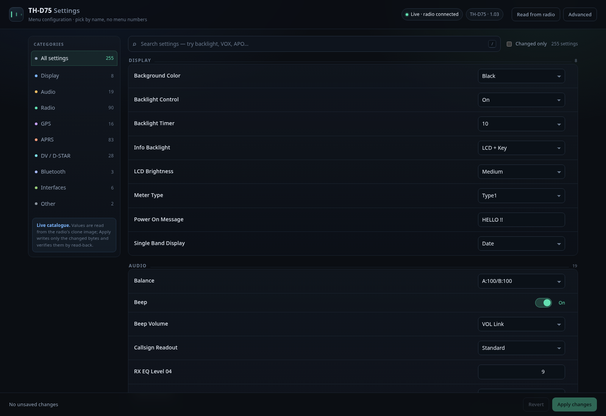

# TH-D75 tools

Open-source tools and reverse-engineering notes for the **Kenwood TH-D75**
amateur radio (V1.03), built and tested on Linux.

Two runnable tools:

- **`settings-ui/`** — web menu editor using a persistent MCP settings session
- **`d75mon/`** — read-only CAT monitor widget

Plus **`docs/`** with the menu map, MCP protocol notes, firmware findings, and
GPS-altitude method.



> ## READ THIS FIRST
>
> **HARD STOP — never do these**
> - Flash firmware, bootloader, or factory-calibration regions.
> - Write to a serial/device target you have not positively identified.
> - Expose the web UI to the internet. It has **no authentication**.
>
> **ASK THE USER FIRST**
> - `sudo`, udev rules, or systemd service installation.
> - Entering settings mode or applying any radio setting.
> - Power-cycling the radio.
> - Binding the web UI to a LAN-facing address.
>
> **PRIVATE DATA**
> `values.json`, backups, clone images, and API responses can contain callsigns,
> coordinates, APRS messages, and Bluetooth names. Keep them local.
>
> The short version is here; details are in [SECURITY.md](SECURITY.md) and
> [docs/SAFETY.md](docs/SAFETY.md).

## The lazy path

For the short version, see [LAZY.md](LAZY.md): let an agent install it, or run
`./scripts/bootstrap.sh --setup` yourself. It asks before
every privileged action and never writes radio settings.

## Mission

> **Make every TH-D75 menu setting discoverable, readable, and changeable on a
> scalable web interface — without the radio's tiny screen or keypad.**

The D75 hides hundreds of settings behind nested menus, a small display, and a
small keypad. This project replaces menu-number hunting with search,
plain-language labels, large controls, and verified writes. It is accessibility
engineering for people with low vision or other needs — and, yes, laziness
engineering for people like me who would rather operate the radio than memorize
its menu tree.

Accessibility and laziness are the same problem here: remove the tiny-screen
tax. Fewer taps, fewer nested menus, fewer numbers to remember.

### Design principles

- **Findability over memorization.** Search by name or keyword, browse by
  category, and keep menu numbers as optional advanced metadata.
- **Readability at any scale.** The interface is responsive, works with browser
  zoom, uses a high-contrast theme, and keeps controls comfortably sized.
- **Minimum friction.** Laziness is a feature. One **Read from radio**, edit,
  **Apply**; cached values; no USB reset per save; a few clicks instead of a
  menu-tree expedition.
- **Keyboard and assistive-tech friendly.** Native form controls, labels and
  ARIA state, `/` to focus search, `Esc` to clear.
- **Safe by default.** Only changed fields are written and read back; high-risk
  settings require confirmation; the bootloader and calibration stay untouched.

### Accessibility status

Current: scalable responsive layout, browser zoom support, high-contrast dark
theme, keyboard search shortcut, native labelled controls, and no requirement
to read or remember menu numbers.

Not yet independently audited: full screen-reader walkthrough and a light
high-contrast theme. Those are explicit hardening items, not afterthoughts.
Accessibility is part of the mission, not a separate mode.

## Requirements

- Linux with Python **3.10+**
- Minimal build tools: `git`, `make`, `python3-venv`/`python3-pip`
  (Debian/Ubuntu: `sudo apt-get install -y git make python3-venv python3-pip ca-certificates usbutils`)
- `pyserial` (installed into a venv below)
- systemd **user** units for service mode
- TH-D75 connected over USB CDC (`/dev/ttyACM*`; `/dev/thd75` recommended)
- No compiler, npm, or frontend build step is required

## Fast path (public release only)

Once the tools repo has a public release:

```bash
curl -fsSL -o thd75-install.sh \
  https://github.com/dennis-kf0rlx/TH-D75-MCP/releases/latest/download/install.sh
less thd75-install.sh
bash thd75-install.sh
```

The installer verifies the tarball checksum, extracts to `~/TH-D75-MCP`, and runs
the interactive setup. On a desktop it opens an install-notes page in the browser
and then redirects to the settings UI. See `docs/INSTALL.md`. The request-only
Agent Skill is not in the release.

## Build

There is nothing to compile; “build” is the Python environment:

```bash
git clone git@github.com:dennis-kf0rlx/TH-D75-MCP.git
cd TH-D75-MCP

python3 -m venv .venv
.venv/bin/pip install -r requirements.txt
```

Or use the included Makefile:

```bash
make venv       # create .venv and install pyserial
make check      # py_compile + d75mon unit tests
```

## Serial-device setup

**ASK FIRST:** this needs `sudo` and changes system device permissions. The
example uses `dialout`; Arch/CachyOS typically uses `uucp` instead.

```bash
# Debian/Ubuntu example — use your distro's serial group on Arch.
sudo tee /etc/udev/rules.d/99-kenwood-thd75.rules >/dev/null <<'UDEV'
SUBSYSTEM=="tty", ATTRS{idVendor}=="2166", ATTRS{idProduct}=="9023", MODE="0660", GROUP="dialout", SYMLINK+="thd75"
UDEV
sudo udevadm control --reload-rules
sudo udevadm trigger
sudo usermod -aG dialout "$USER"
```

Log out/in after changing groups, then verify:

```bash
ls -l /dev/thd75
```

`MODE="0666"` is deliberately not used: the serial port controls a
transmitter-capable radio and should not be world-writable.

## Run: settings UI

**The UI is unauthenticated.** It binds to **127.0.0.1** by default. Keep it
local, or access it over an SSH tunnel. Only set a LAN-facing host when you
intend to expose it on a trusted, firewall-restricted network.

```bash
.venv/bin/python settings-ui/server.py
# http://127.0.0.1:8098/
```

SSH tunnel from another machine:

```bash
ssh -L 8098:127.0.0.1:8098 user@radio-host
# then open http://127.0.0.1:8098/ on the client
```

Explicit LAN opt-in (warned in the log):

```bash
D75SETTINGS_HOST=0.0.0.0 .venv/bin/python settings-ui/server.py
```

The UI:

1. loads the catalog and cached values (no radio I/O on page load);
2. **Read from radio** pauses `d75mon`, enters MCP once, and reads all fields;
3. edits/Apply use the same persistent MCP session;
4. **Exit settings** leaves MCP (one USB reset), waits for re-enumeration, and
   restarts `d75mon`.

**ASK FIRST before applying settings or entering settings mode** on someone
else's radio. Settings mode holds the radio and can require a power cycle if
something goes wrong.

If you do not run `d75mon`, start settings-ui with a monitor unit that exists or
adjust `D75_MONITOR_UNIT`; the service expects the same user as the monitor.

### Service mode

**ASK FIRST:** this installs a systemd user unit that can change radio settings.

```bash
mkdir -p ~/.config/systemd/user
cp settings-ui/systemd/d75settings.service.example \
   ~/.config/systemd/user/d75settings.service
# Edit WorkingDirectory/ExecStart if you cloned outside ~/TH-D75-MCP.
systemctl --user daemon-reload
systemctl --user enable --now d75settings.service
```

The example unit uses loopback and `%h/TH-D75-MCP` + `.venv`.

### Settings environment

| Variable | Default | Meaning |
|---|---|---|
| `D75SETTINGS_HOST` | `127.0.0.1` | bind address; loopback only by default |
| `D75SETTINGS_PORT` | `8098` | HTTP port |
| `D75_SERIAL` | `/dev/thd75` | radio serial device |
| `D75_MONITOR_UNIT` | `d75mon` | systemd user monitor unit |
| `D75SETTINGS_IDLE` | `300` | idle seconds before releasing MCP |
| `D75SETTINGS_KEEPALIVE` | `0.5` | MCP keepalive interval, seconds |

Run from any directory; the server locates its own static files.

## Run: d75mon monitor

The monitor defaults to **127.0.0.1** as well. Use an SSH tunnel for remote
viewing, or set `host` to a LAN IP in `d75mon/config.json` deliberately.

```bash
.venv/bin/python d75mon/backend/d75mon.py --config d75mon/config.json
# http://127.0.0.1:8099/
```

### d75mon tests

```bash
.venv/bin/python -m unittest discover -s d75mon/tests
```

### d75mon service

**ASK FIRST:** this installs a persistent systemd user unit.

```bash
mkdir -p ~/.config/systemd/user
cp d75mon/systemd/d75mon.service.example ~/.config/systemd/user/d75mon.service
# Edit paths if needed, then:
systemctl --user daemon-reload
systemctl --user enable --now d75mon.service
```

### d75mon configuration

Edit `d75mon/config.json`:

```json
{
  "host": "127.0.0.1",
  "port": 8099,
  "transport": "auto",
  "usb_candidates": ["/dev/thd75", "/dev/ttyACM0"],
  "bluetooth": "/dev/rfcomm0",
  "baudrate": 9600,
  "web_dir": "web",
  "asset_dir": ""
}
```

- `transport`: `auto`, `usb`, or `bluetooth`
- `asset_dir`: optional directory for firmware-image assets
- Live VFO/screen fields require the documented firmware-assisted `GM` reader;
  stock V1.03 exposes only the text-CAT status fields. The unpatched monitor
  labels missing fields honestly.

Existing LAN installs must explicitly set `D75SETTINGS_HOST=0.0.0.0` (or change
`d75mon/config.json`) and firewall the ports; the new defaults are intentionally
local-only.

## Network security

Neither service has authentication. Treat both as **local administrative
interfaces**:

- default bind: loopback
- remote access: SSH tunnel, not port-forwarding
- no internet exposure, no public reverse proxy
- if LAN access is unavoidable, firewall to trusted source addresses

See [SECURITY.md](SECURITY.md) for the threat model and private-data notes.

## GPS altitude

Only when the user asks. Read-only sequence after stopping the monitor:

1. Send `GP 1,1\r` at 9600 baud to enable GPS PC output.
2. Stop sending CAT; listen for NMEA `$GPGGA` / `$GPRMC`.
3. Parse GGA altitude and geoid separation.
4. Restore with `GP 1,0\r`; restart `d75mon`.

NMEA and CAT share the stream. No USB reset is needed, but a weak fix can have
large vertical error. Full procedure: `docs/gps-altitude.md`.

**ASK FIRST:** the `GP 1,1` step changes a radio setting.

## Agent skill (request-only)

The install/operate Agent Skill is intentionally **not part of the public tools
release**. It lives in this private repo today; before the tools repo is made
public, move `skills/th-d75-tools/` to the private `TH-D75-agent-skill` repo
(see `docs/RELEASE.md`). Access is granted by request; do not redistribute it.

The public repo keeps a request stub at `skills/REQUEST-ACCESS.md`. The skill
covers install-only, monitor-only, and explicitly confirmed settings-operation
modes, with read-only defaults and consent gates for `sudo`, systemd, udev,
radio writes, and power-cycling.

## Verify the build

```bash
make check             # 9 tests
make test-installer    # build local release fixture + test installer end-to-end
```

`make test-installer` needs no GitHub release, sudo, services, or radio. See
`docs/TESTING.md`.

```bash
make check
```

Equivalent:

```bash
.venv/bin/python -m py_compile \
  settings-ui/server.py settings-ui/generate_catalog.py \
  d75mon/backend/d75mon.py d75mon/tests/test_cat.py
.venv/bin/python -m unittest discover -s d75mon/tests
```

## Regenerate the settings catalog

`settings-ui/catalog.json` is committed, so this is optional. Inputs are the
upstream MCP-D75 menu schema, this repo's `docs/*.tsv`, and the upstream menu
number index:

```bash
.venv/bin/python settings-ui/generate_catalog.py \
  --schema /path/to/mcp_d75_menu_schema.json \
  --menu-map docs/menu-map.tsv \
  --menu-rows docs/menu-rows.tsv \
  --swift-index /path/to/THD75MenuNumberIndex.swift \
  --out settings-ui/catalog.json
```

## Repo layout

```text
settings-ui/          web settings editor + backend
  server.py
  index.html / styles.css / app.js / catalog.js
  catalog.json
  generate_catalog.py
  systemd/d75settings.service.example
d75mon/               read-only monitor widget
  backend/d75mon.py
  web/
  config.json
  systemd/d75mon.service.example
  tests/
docs/                 menu map, row map, MCP protocol, firmware findings, GPS
skills/               request-gated Agent Skill + public request stub
infra/proxmox/        disposable-VM test runway (maintainer use)
screenshots/
install.sh
Makefile
requirements.txt
```

## Maintainer VM runway

`infra/proxmox/` documents a disposable Debian VM template and helper flow for
install/systemd testing. Snapshots reset the VM, not the radio. Radio acceptance
stays on a physical host; do not trust a VM snapshot to recover a wedged MCP
session.

## MCP notes

- Entry is `0M PROGRAM\r` — **no leading CR**. A leading CR produces `?\r` and
  breaks strict upstream implementations.
- Page read/write frames are documented in `docs/mcp-protocol.md`.
- The MCP session times out after roughly **2 s of idle**. A **0.5 s**
  keepalive page read keeps it open without a USB reset.
- Entry does not reset USB; exit does. Expect exactly one reset when leaving
  settings mode.
- CHIRP's clone path works but performs a full image transfer and multiple USB
  resets; the persistent MCP session is the interactive path.

## Troubleshooting

- **`/dev/thd75` missing** — check `lsusb | grep 2166`, the udev rule/group,
  cable, and radio power. A failed MCP session may require a physical power
  cycle.
- **`Permission denied` on serial** — join the correct serial group (`dialout`
  / `uucp`), re-login, and confirm `ls -l /dev/thd75`.
- **MCP short read / CAT unresponsive** — power-cycle the radio. Do not loop
  MCP entries on a wedged session.
- **`d75mon` stopped in settings mode** — intentional; Exit settings restarts it.
- **HTTP 409** — another read/apply is in flight; retry after it finishes.
- **GPS altitude jumps** — NMEA altitude is only as good as the fix; 4-satellite
  fixes can be tens of metres off vertically.

## Documentation

- `SECURITY.md` — no-auth threat model, LAN rules, private data
- `docs/SAFETY.md` — radio/firmware/MCP hard stops and recovery
- `docs/menu-map.md` / `docs/menu-map.tsv` — 400 settings
- `docs/menu-rows.tsv` — 217 firmware menu rows
- `docs/firmware-findings.md` — menu/string/CAT findings
- `docs/mcp-protocol.md` — entry, page frames, ACKs, keepalive
- `docs/gps-altitude.md` — NMEA altitude capture
- `docs/REFERENCES.md` — upstream projects consulted
- `docs/PROVENANCE.md` — data sources and redistribution caveats
- `docs/INSTALL.md` — curl installer and release-asset contract
- `docs/TESTING.md` — local installer/server/browser-preview test loop
- `docs/BARE-METAL.md` — off-LAN USB-kit test on a generic desktop
- `docs/BLUETOOTH.md` — Classic SPP CAT, pairing, rfcomm, settings UI
- `infra/systemd/thd75-bt-bind.service.example` — persistent Bluetooth bind
- `scripts/uninstall.sh` — remove an installed instance safely
- `docs/RELEASE.md` — public-release and skill-split checklist
- `LAZY.md` — shortest install path for humans
- `docs/CLEANROOM.md` — fresh-agent install/build test record
- `skills/REQUEST-ACCESS.md` — request-only skill access

## License

Original code and docs are **MIT** licensed (see `LICENSE`). Third-party
references remain under their own licenses; see `docs/REFERENCES.md`.
